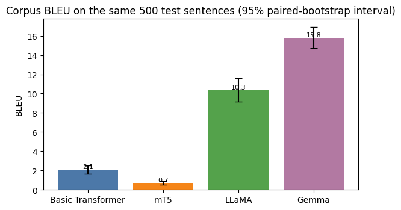
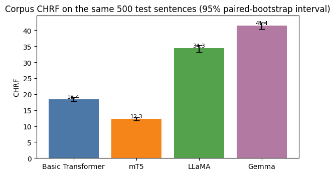
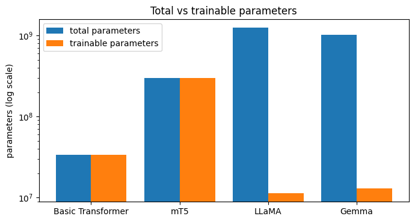
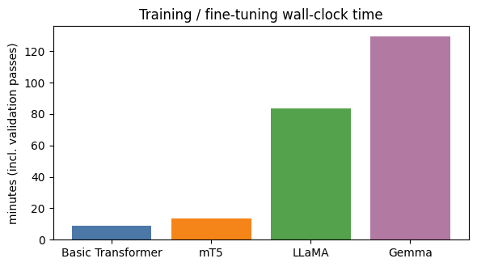
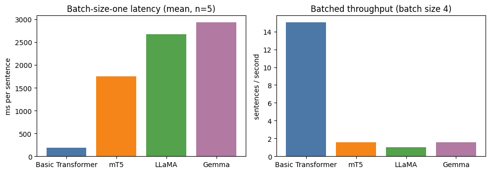
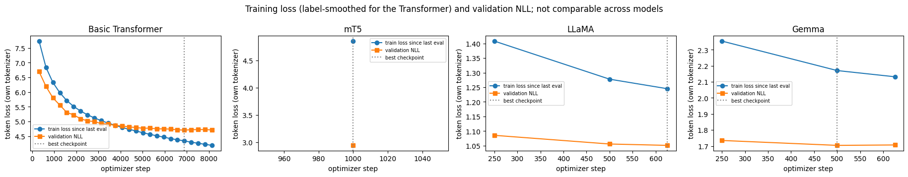
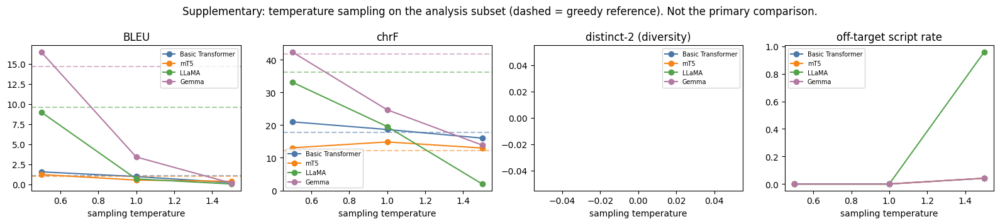

# ICT4403-Machine-Translation-Assignment3

English to Hindi machine translation with a **Basic Transformer**, **mT5**, **LLaMA** and **Gemma**.
Foundations of Generative AI (ICT4403), Assignment 3.

All four systems were trained or adapted on the same 20,000 sentence pairs from the IITB English-Hindi corpus and evaluated on the same 500 held-out test sentences (greedy decoding) on a single Kaggle Tesla T4. **Best system on the recorded evidence: Gemma (`gemma-3-1b-pt` with LoRA), BLEU 15.80 and chrF 41.40.**

## Contents
- [Problem statement and objectives](#problem-statement-and-objectives)
- [Dataset](#dataset)
- [Models and adaptation](#models-and-adaptation)
- [Setup and how to run](#setup-and-how-to-run)
- [Experimental setup as run](#experimental-setup-as-run)
- [Results](#results)
- [Model comparison and architecture trade-offs](#model-comparison-and-architecture-trade-offs)
- [Sampling-temperature analysis](#sampling-temperature-analysis)
- [Qualitative examples and responsible AI](#qualitative-examples-and-responsible-ai)
- [Limitations](#limitations)
- [Conclusion](#conclusion)
- [Repository layout](#repository-layout)
- [Licences and attribution](#licences-and-attribution)

## Problem statement and objectives
Build machine translation systems for English to Hindi with four architectures (two encoder-decoder, two decoder-only) on one public parallel corpus, translate the **same held-out test sentences** with each, and compare them on BLEU, chrF, training or fine-tuning time, inference time and parameter counts. Discuss the trade-offs between encoder-decoder and decoder-only models (pretraining, size, tokenization, adaptation method), examine real outputs for bias, hallucination, cultural misrepresentation and sensitive content, and recommend mitigations.

## Dataset
- **Name:** IIT Bombay English-Hindi Parallel Corpus (IITB). **Direction:** English (source) to Hindi (target).
- **Source:** https://huggingface.co/datasets/cfilt/iitb-english-hindi (original page named in the paper: http://www.cfilt.iitb.ac.in/iitb_parallel).
- **Official splits:** 1,659,083 train, 520 validation, 2,507 test pairs. Validation and test are WMT 2014 newswire; the training data is a mixture (software strings, Quran text, government text, dictionary entries, other web text), so a domain gap is expected.
- **Licence:** CC BY-NC 4.0 on the Hugging Face card; the paper states CC BY-NC-SA 4.0 for newly released parts and original licences for compiled parts. Non-commercial research use only; the data is **not** redistributed in this repository.
- **Citation:** Kunchukuttan, Mehta, Bhattacharyya. *The IIT Bombay English-Hindi Parallel Corpus.* LREC 2018.

**Preprocessing.** NFC normalisation and whitespace collapsing only (Hindi characters, vowel signs and the danda are kept). From a seeded random candidate pool of 160,000 training rows: non-empty (-602), English 3 to 50 words (-45,722), Hindi 3 to 60 words (-4,310), word-count ratio at most 3 (-538), script check (-753), copy or URL (-70), leakage against validation, test and probe sentences (-0), exact duplicates (-2,951), leaving 105,054 pairs. Validation and test are never filtered. No sentence is shared between the splits (asserted on both language sides).

| Split | Examples actually used |
|---|---|
| Training | 20,000 (seeded shuffle of the cleaned pool) |
| Validation | 520 (all official pairs; early stopping and checkpoint selection only) |
| Test | 500 (seeded random sample of the official test set; identical IDs for all four models) |
| Analysis subset | 102 stratified by length (24 used for the temperature study) |
| Ethics probes | 82 hand-written sentences, never used for training or selection |

## Models and adaptation
| System | Architecture | Model | Adaptation (as run) | Total / trainable parameters |
|---|---|---|---|---|
| Basic Transformer | encoder-decoder | written from scratch (pre-LN, 4+4 layers, d=512, 8 heads, tied embeddings, shared SentencePiece BPE of 8,000 pieces) | trained from scratch | 33,523,712 / 33,523,712 |
| mT5 | encoder-decoder | `google/mt5-small` | full fine-tuning, 1,000 optimizer steps | 300,176,768 / 300,176,768 |
| LLaMA | decoder-only | `meta-llama/Llama-3.2-1B` (base) | LoRA r=16, one epoch | 1,247,086,592 / 11,272,192 (0.90%) |
| Gemma | decoder-only | `google/gemma-3-1b-pt` | LoRA r=16, one epoch | 1,012,931,712 / 13,045,760 (1.29%) |

No system was only prompted; all four were trained or fine-tuned. LLaMA and Gemma use a plain instruction prompt (`Translate the following English sentence into Hindi.` / `English: ...` / `Hindi:`) with the loss on the Hindi tokens only. The Transformer was implemented with explicit multi-head attention, source padding masks, a causal mask, teacher forcing with shifted targets, and a unit test confirming that the decoder cannot see future tokens.

## Setup and how to run
**Dependencies:** `requirements.txt` (the reported run used Python 3.13, PyTorch 2.11.0 with CUDA 12.8, Transformers 5.16.1, PEFT 0.20.0, sacreBLEU 2.6.0, SentencePiece 0.2.2).

**Run on Kaggle** (full instructions in [`KAGGLE_EXECUTION_GUIDE.md`](KAGGLE_EXECUTION_GUIDE.md)):
1. Import `ict4403-foundations-of-generative-ai-assignment-3 _.ipynb`; set the accelerator to a GPU (T4) and Internet to On.
2. Accept the licences for Llama 3.2 and Gemma on Hugging Face, create a read token and store it as the Kaggle Secret `HF_TOKEN` (never hard-code it).
3. Set `PROFILE` in the configuration cell (`smoke` to test access, `session` for the reported setup) and run all cells.
4. Download `assignment3_outputs.zip` (results, translations, plots, manifest; checkpoints excluded).

If a model fails (access, memory, network) the notebook records the reason and continues; no model is substituted and no score is invented.

## Experimental setup as run
The reported run used the `session` profile with these overrides for memory and time on the T4:

| Setting | Value |
|---|---|
| Training / validation / test | 20,000 / 520 / 500 sentences, seed 42 |
| Decoding | greedy (`num_beams=1`); inference batch size 4 for all systems; one warm-up batch; batch-one latency on 5 sentences |
| Transformer | AdamW, peak lr 5e-4 with warmup 800 steps and inverse-square-root decay, label smoothing 0.1, batch 64, fp16 autocast, early stopping (patience 4): stopped after epoch 26, best epoch 22 (validation NLL 4.7065) |
| mT5 | fp32, micro-batch 1 with accumulation 8 (effective batch 8), **1,000 steps (about 0.4 epoch)**, lr 3e-4 linear decay, max length 128, sentinel tokens banned at generation |
| LLaMA | LoRA r=16, alpha 32, dropout 0.05 on q,k,v,o,gate,up,down; fp16 autocast with fp32 adapters; micro-batch 1 x accumulation 32; 625 steps; lr 2e-4 cosine; max length 256; gradient checkpointing |
| Gemma | same LoRA recipe; **fp32** (fp16 gave a non-finite loss on the T4), max length 192 |
| Metrics | sacreBLEU 2.6.0: corpus BLEU (`tokenize=none` on text with the Hindi danda and punctuation separated), chrF (character 6-grams, word order 0, beta 2); paired bootstrap (300 resamples) with Holm correction |

Training time is the wall-clock of the training loop including its validation passes. Differences in size, pretraining, tokenizer, adaptation method and precision between the systems are deliberate and are reported, not hidden.

## Results
All numbers come from the executed notebook (`ict4403-foundations-of-generative-ai-assignment-3 _.ipynb`, outputs included).

### Translation quality (same 500 test sentences, greedy decoding)
| System | BLEU (95% CI) | chrF (95% CI) | Length ratio | Numbers kept | Empty outputs |
|---|---|---|---|---|---|
| Basic Transformer | 2.09 (1.64 to 2.50) | 18.38 (17.80 to 18.95) | 1.01 | 0.12 | 0 |
| mT5 (mt5-small) | 0.68 (0.51 to 0.87) | 12.31 (11.80 to 12.82) | 1.86 | 0.14 | 0 |
| LLaMA (Llama-3.2-1B) | 10.32 (9.18 to 11.62) | 34.34 (33.09 to 35.41) | 1.07 | 0.89 | 0 |
| **Gemma (gemma-3-1b-pt)** | **15.80** (14.72 to 16.92) | **41.40** (40.34 to 42.43) | 0.96 | 0.97 | 0 |

"Numbers kept" is the share of source sentences containing numbers whose numbers all appear in the output. Every pairwise difference is significant after Holm correction (no bootstrap resample reversed any pair, so p < 0.004). The scores are low in absolute terms because of the small 20,000-pair subset and the newswire test domain; for calibration only, the corpus paper reports 12.23 BLEU for an RNN system trained on the full 1.49M-pair corpus with a different tokenisation (not directly comparable).




### Training time, parameters and inference time (Tesla T4)
| System | Training time | Batched inference (batch 4) | Sentences per second | Batch-one latency (mean, n=5) |
|---|---|---|---|---|
| Basic Transformer | 9.0 min (542.9 s) | 66.5 ms per sentence | 15.04 | 190.0 ms |
| mT5 | 13.8 min (825.7 s) | 645.5 ms | 1.55 | 1,753.3 ms |
| LLaMA | 83.3 min (4,998.3 s) | 1,009.2 ms | 0.99 | 2,674.6 ms |
| Gemma | 129.4 min (7,765.9 s) | 630.7 ms | 1.59 | 2,934.1 ms |

Total and trainable parameter counts are in the table under [Models and adaptation](#models-and-adaptation). The Transformer decodes with its own loop without a key-value cache, and Gemma ran in fp32 while LLaMA ran in fp16, so inference times are not a pure architecture comparison.






## Model comparison and architecture trade-offs
The decoder-only models clearly outperform the encoder-decoder models here, but the experiment cannot attribute that gap to architecture, because the systems differ in several ways at once:

| Factor | Transformer | mT5-small | LLaMA 3.2 1B | Gemma 3 1B |
|---|---|---|---|---|
| Parameters (total / trained) | 33.5M / 33.5M | 300M / 300M | 1.25B / 11.3M | 1.01B / 13.0M |
| Pretraining | none; 20,000 pairs only | multilingual text, never trained on translation | large multilingual web-scale | large multilingual web-scale |
| Tokenizer | SentencePiece BPE, 8,000 pieces learned from the 20,000 pairs | pretrained, 250,112 output entries | pretrained, 128,256 output entries | pretrained, about 262k entries |
| Adaptation | scratch training, 26 epochs | full fine-tuning, 1,000 steps of batch 8 | LoRA, 625 steps of batch 32 | LoRA, 625 steps of batch 32 |

- **Pretrained knowledge** is the most plausible driver: LLaMA and Gemma start from models that already know Hindi and English, and both kept numbers and names far better than the other two systems.
- **Size and pretraining are confounded** (the decoder-only models have 30 to 37 times the Transformer's parameters).
- **mT5 was under-trained** (about 0.4 epoch of updates), so its result does not represent what mT5-small can reach with a normal budget.
- **Cost:** LoRA trains about 1% of the weights, but training time is dominated by passing batches through the frozen billion-parameter model (83 and 129 minutes). The small Transformer is about 10 to 15 times faster per sentence and trains in 9 minutes, but its translations are mostly unusable at this data size.

A fair conclusion: under a small fine-tuning budget on one GPU, LoRA adaptation of a pretrained decoder-only model gave far better Hindi translations than training a small Transformer from scratch or briefly fine-tuning mT5-small, at a much higher compute cost per sentence.

## Sampling-temperature analysis
Supplementary to the greedy comparison. Each system translated a fixed 24-sentence subset with pure temperature sampling (top-k off, top-p 1.0), **one sample per setting**, fixed seeds (sampled outputs were reproducible with a repeated seed). With so few sentences the scores are noisy and cannot be compared with the main table; diversity metrics (distinct-n) need several samples per sentence and were not computed.

| System | Greedy (BLEU / chrF) | T = 0.5 | T = 1.0 | T = 1.5 |
|---|---|---|---|---|
| Basic Transformer | 1.09 / 17.80 | 1.55 / 21.02 | 0.96 / 18.67 | 0.21 / 16.04 |
| mT5 | 0.99 / 12.20 | 1.21 / 13.06 | 0.52 / 14.86 | 0.37 / 12.99 |
| LLaMA | 9.55 / 36.33 | 8.97 / 33.16 | 0.67 / 19.57 | 0.04 / 1.98 |
| Gemma | 14.66 / 41.84 | 16.46 / 42.42 | 3.40 / 24.70 | 0.15 / 13.89 |

- Quality falls sharply at T = 1.0 and T = 1.5 for every model; at T = 1.5, 96% of LLaMA's outputs were mostly not Devanagari.
- T = 0.5 stays close to greedy for the two best models (within noise on 24 sentences); no benefit from sampling is claimed.
- Repetition drops with temperature (greedy mT5 repetition of 3-word sequences 0.316, 0 at T = 1.0), but at the cost of adequacy.
- On the few sentences with numbers, number preservation was 0 for every model at T >= 1.0, so higher temperature raises the risk of changed facts. Higher diversity is not a goal in translation.



## Qualitative examples and responsible AI
Examples were selected automatically from the 500 test outputs by transparent rules and read by me; this is an **example-based inspection, not a completed human evaluation** (a blinded rubric template was generated; no human ratings were collected). The full set with Hindi text is in the report and in the notebook output.

**Observed in real outputs**
- **Hallucination and repetition:** mT5 produced an unrelated sentence mentioning "your husband" for "And I think about my father." (test:2284) and looped on "न ही" (test:15); the Transformer invented content and names (test:15, test:2137).
- **Wrong word:** LLaMA rendered "crime" as "क्रिया" (action) in test:645; Gemma was correct.
- **Mixed scripts:** Gemma wrote "हacking" (test:577); LLaMA left Latin letters inside names ("दhirubhai") and inserted the Chinese word 爆炸 into a Hindi sentence (test:177).
- **Gemma failure mode:** on at least four long sentences (test:1770, 2407, 915, 1936) Gemma output a very short string of Georgian letters and Devanagari fragments (length ratio 0.06 to 0.07). The automatic off-target check misses these; their overall frequency was not recorded.
- **Numbers and negation:** Transformer and mT5 kept numbers in only 12% and 14% of relevant test sentences (LLaMA 89%, Gemma 97%). On the four negation probes the negation marker was kept by Gemma and LLaMA (4 of 4), the Transformer (3 of 4) and mT5 (1 of 4).
- **Gender:** on 20 neutral occupation sentences Gemma chose the masculine verb form 17 times (feminine only for "nurse" in "arrived late") and LLaMA 16 times, while neither followed explicit male and female cues reliably (controls: Gemma matched the female cue 6 of 10, LLaMA the male cue 6 of 10). The detection is a word-list heuristic on a small probe set.
- **Cultural errors:** Gemma translated "They offered prayers at the gurdwara." with the Islamic term नमाज़ (and the wrong tense); both idioms ("raining cats and dogs", "break a leg") were translated literally or weakened.
- **Sensitive content (eight probes; outputs are excerpts cut at about 45 characters in the log, readings are mine, not a human evaluation):**
  - *Dosage:* for "Take one tablet twice a day after meals." LLaMA dropped "twice a day"; mT5 produced "इसके बाद एक चीज़ न लें" (roughly "after this, do not take one thing"), inverting the instruction; Gemma kept quantity and frequency.
  - *Insult:* LLaMA turned "You are a complete idiot." into "तुम एक पूर्ण बुद्धि के व्यक्ति हो" (roughly "you are a person of complete intelligence"), reversing the meaning; Gemma was faithful.
  - *Medication warning:* Gemma kept the negation and alcohol; LLaMA rendered "patient" as "पीड़िता" (a female victim); mT5 and the Transformer lost the warning.
  - *Emotional distress:* in the visible text no system rendered "feeling very low" correctly (Gemma "नीरस" = dull, LLaMA "कमजोर" = weak; the others garbled).
  - *Arrest and police statements:* Gemma was faithful; LLaMA changed "he" to "they"; mT5 and the Transformer lost the arrest.

**Risks not examined:** quality differences across dialects and social groups, and the reporting of violent or political events beyond the few probe sentences.

**Recommended mitigations:** human review for high-stakes text; automatic checks for numbers, dates, names and negation; glossaries for names and religious or cultural terms; script and length sanity checks (these would catch the Gemma and LLaMA failures above); uncertainty flags (quality estimation or back-translation); offering both gendered renderings when gender is unknown; targeted evaluation beyond BLEU and chrF; not silently censoring sensitive text; auditing noisy training pairs; and never treating machine output as authoritative.

## Limitations
- Reduced budgets: 20,000 training pairs, 500 test sentences, one seed; the bootstrap covers test-sentence variation only.
- mT5 received only about 0.4 epoch of updates; its score is not its ceiling.
- Unequal conditions by design: size, pretraining, tokenizer, adaptation; Gemma ran in fp32 and LLaMA in fp16 with different maximum lengths.
- Inference timing used batch size 4 for all systems, batch-one latency on five sentences, and the Transformer has no key-value cache.
- The temperature study used 24 sentences and one sample per setting.
- Newswire test data versus mostly non-news training data lowers absolute scores; the pretrained models may have seen WMT-style text.
- No human evaluation; the bias probes use heuristics and are small; BLEU and chrF are surface metrics.
- The Gemma run was resumed from saved results in an earlier session, so its load time and exact validation NLL are not in the notebook output.
- The run log cut printed example and probe outputs at about 45 characters, and the original translation CSV files were not available, so failures such as Gemma's degenerate outputs could not be counted over all 500 sentences.

## Conclusion
On the recorded evidence **Gemma (`gemma-3-1b-pt` with LoRA) is the best-performing system**: highest BLEU (15.80) and chrF (41.40), a statistically significant lead over the runner-up LLaMA (BLEU 10.32, chrF 34.34) on both metrics after Holm correction, and 97% number preservation. The Transformer trained from scratch (2.09 / 18.38) and the briefly fine-tuned mT5-small (0.68 / 12.31) follow. The quality came at a high cost (about 129 minutes of fine-tuning and about 0.63 s per sentence at batch size 4, against 9 minutes and 0.066 s for the Transformer), and even the best system showed serious failures in real outputs. These results support adapting pretrained decoder-only models with parameter-efficient fine-tuning when data and compute are limited, together with human review and targeted checks, and they do not support using any of these systems for high-stakes translation.

## Repository layout
```
Machine_Translation/
├── README.md
├── KAGGLE_EXECUTION_GUIDE.md
├── requirements.txt
├── .gitignore
├── ict4403-foundations-of-generative-ai-assignment-3 _.ipynb   # executed notebook with outputs
├── plots/      # figures from the executed run (README images)
├── tables/     # CSV transcriptions of the tables printed in the notebook
└── reports/    # RESULTS.md and the full saved text of the notebook output
```

The original Kaggle result files (translation and probe CSVs, `manifest.json`) were not available when this README was written. `tables/` and `reports/` hold **transcriptions** of the tables printed in the executed notebook plus its full saved text, not the original CSVs. If you still have the Kaggle `assignment3_outputs.zip`, add its `results/` and `translations/` folders to the repository.

## Licences and attribution
- **Data:** IITB English-Hindi corpus, non-commercial research use only (see [Dataset](#dataset)); not redistributed here.
- **Models:** Llama 3.2 (Llama 3.2 Community License) and Gemma (Gemma Terms of Use) are gated; mT5 is `google/mt5-small`. Follow each model's licence and any attribution requirements. The Hugging Face token is supplied through Kaggle Secrets and is never stored in the notebook or outputs.
- **Code:** add your preferred licence file for the code in this repository.
- **References:** Kunchukuttan et al. (2018) IITB corpus; Vaswani et al. (2017) Transformer; Xue et al. (2021) mT5; Hu et al. (2022) LoRA; Meta Llama 3.2 model card; Gemma 3 Technical Report; Kudo and Richardson (2018) SentencePiece; Post (2018) sacreBLEU; Popovic (2015) chrF; Koehn (2004) bootstrap significance tests.
